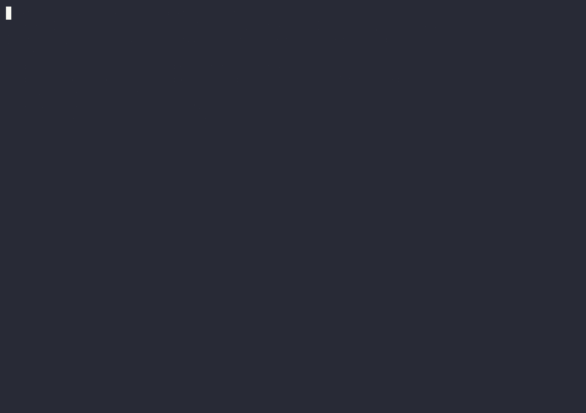

# One escalation run past a provider failure: the Wordle sample (Certo 0.1.22)

One real `certo --escalate` run of the sample task `certo init` ships,
`tasks/wordle.md`, with a two-model ladder whose first model can't be
reached. It shows what `--escalate` does when a provider fails: the task
moves to the next model, which still has to pass the checks. It is one
run, not a benchmark.

**For the demo, the first model's API key was invalid on purpose.**
Anthropic rejected it; this was not an outage.



The recording is also in asciinema's format:
[escalation-provider-failure-0.1.22.cast](../assets/escalation-provider-failure-0.1.22.cast)
(`asciinema play` shows it in a terminal). The GIF is the recording at
normal speed, with pauses longer than 2 seconds cut to 2 seconds.

## The setup

- **Certo:** 0.1.22 (not released yet), from a source checkout at commit
  `5739fe8`. **Run:** 2026-10-22, from 14:21 UTC, in a new, empty project
  folder.
- **Machine running Certo:** Darwin 25.6.0, arm64, Apple M1, 16 GB RAM.
- **Settings:** the defaults (checks on, up to 2 fix attempts, 30 minutes
  and 50 steps), plus a cost cap, `CERTO_MAX_TASK_COST=0.50`.
- **Command:**

  ```bash
  certo tasks/wordle.md --project wordle --escalate
  ```

The ladder, `default` in `escalation.yaml`:

```yaml
escalation:
  ladders:
    default:
      - model: claude-sonnet-5-5
      - model: gpt-5.6-luna
```

And in `models.yaml`, the first model with a key Anthropic rejects:

```yaml
models:
  # Rung 1: a key that is rejected on purpose, for the demo.
  - name: claude-sonnet-5-5
    api_key: "sk-ant-demo-invalid-key"
  - name: gpt-5.6-luna
    api_key: "${OPENAI_API_KEY}"
```

## What it printed

The start, up to the second model's first action. The folder paths are
shortened; nothing else is changed:

```text
Warning (models.yaml): Ladder 'default': gpt-5.6-luna (capability 10) comes after claude-sonnet-5-5 (capability 13) but is rated less capable. Allowed, but check the order.
── Certo 0.1.22 ────────────────────────────────────────────
  Model    escalate: claude-sonnet-5-5 → gpt-5.6-luna
  Folder   …/certo-demo/projects/wordle (project wordle)
  Runs on  this computer
  Checks   on, up to 2 fix attempts
  Limits   30 min · 50 steps · $0.50
────────────────────────────────────────────────────────────
Escalation: explicit ladder 'default', 2 rung(s):
  1. claude-sonnet-5-5
  2. gpt-5.6-luna
Certo: Created the project environment …/certo-demo/projects/wordle/.venv (/usr/local/bin/uv venv).
System prompt: 276 lines (--verbose shows it)
Task: Wordle in the terminal (210 lines with the skills; --verbose shows them)
Certo: claude-sonnet-5-5 failed: the provider rejected its API key (LLMAuthenticationError); escalating to gpt-5.6-luna (rung 2 of 2).
System prompt: 291 lines (--verbose shows it)
Task: Wordle in the terminal (with Certo's note about the previous model, 251 lines with the skills; --verbose shows them)
```

The end of the run:

```text
Verification: verified

Run summary:
  Total running time: 1m 32s
  Models: openai/gpt-5.6-luna
  Total tokens: 194,394 (input 185,886, of which cached 163,778; output 8,508)
  Total cost: $0.0190
  Rungs:
    1. claude-sonnet-5-5 (anthropic/claude-sonnet-5-5): provider or run failure, 0 fix attempts, 1.5s, 0 tokens, $0.0000
    2. gpt-5.6-luna (openai/gpt-5.6-luna): verified, 0 fix attempts, 1m 30s, 194,394 tokens, $0.0190
  Final result from rung 2 (gpt-5.6-luna).
```

## What it shows

- **A provider failure moves the task on.** The first model's request was
  rejected 1.5 seconds in, before it changed any file. Certo named the
  reason in one line and gave the task to the next model, with no prompt
  and no restart.
- **The next model still had to pass the checks.** `gpt-5.6-luna` wrote
  the game (`wordle.py`, `wordle_logic.py`), its tests and a README. Its 5
  tests passed when Certo ran them, so the verdict was `verified`, with no
  fix attempt.
- **The failure cost nothing.** The rejected request used no tokens; the
  whole run cost $0.0190.
- **The run left its records.** `MODEL_DECISIONS.md` in the project
  records the ladder, the climb with the full provider error, and why the
  climb stopped.

## Limits

One task, one run, with a failure made on purpose. A real outage can look
different: a rate limit or a server that doesn't answer may take longer to
fail than a rejected key, because the SDK retries some errors before
giving up.

Two details of this run's records were wrong, and were fixed after it in
the same version: `MODEL_DECISIONS.md` said the ladder came from
`models_list.yaml` (it comes from `escalation.yaml`), and the note at the
end of the project's `README.md` named `claude-sonnet-5-5` as a model that
wrote code, although it changed no file.
